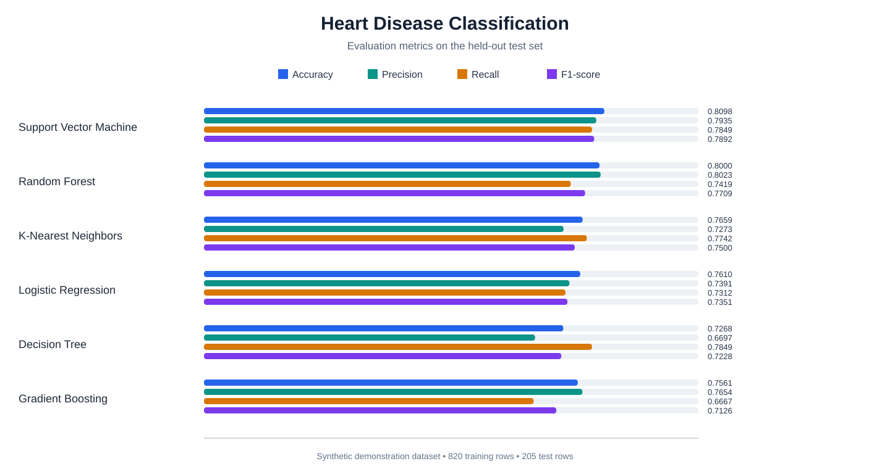
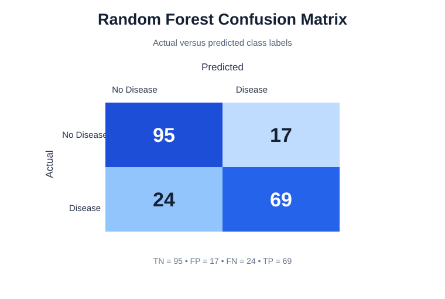

# Ex. No. 4(b) - Machine Learning Model: Heart Disease Prediction

## Aim
To build and compare machine-learning classification models that predict the presence or absence of heart disease from patient-related input features.

## Software Requirements
- Python 3.x
- NumPy
- Pandas
- Matplotlib
- Seaborn
- Scikit-learn

## Dataset Description
The program generates a reproducible **synthetic demonstration dataset** containing 1,025 records. It does not use a downloaded CSV or real patient records.

| Attribute | Description |
|---|---|
| `age` | Age |
| `sex` | Sex category code |
| `chest_pain_type` | Chest-pain category code |
| `resting_bp` | Resting blood pressure |
| `cholesterol` | Cholesterol value |
| `fasting_blood_sugar` | Fasting blood-sugar category |
| `resting_ecg` | Resting ECG category |
| `max_heart_rate` | Maximum heart rate |
| `exercise_angina` | Exercise-induced angina category |
| `oldpeak` | ST-depression demonstration value |
| `slope` | Slope category |
| `major_vessels` | Major-vessels category |
| `thal` | Thalassemia category code |
| `target` | 0 = No disease; 1 = Disease |

The feature values are generated for programming practice and are not clinically validated measurements. This experiment is not a medical diagnostic tool.

## Problem Statement
Train classification algorithms using patient-related features, predict the binary target, and compare model performance on unseen test data.

## Procedure
1. Import the required Python libraries and Scikit-learn classifiers.
2. Generate the synthetic dataset using `make_classification` with a fixed random seed.
3. Map generated feature values to demonstration ranges and create a Pandas DataFrame.
4. Display the first five records, dataset dimensions and missing-value counts.
5. Separate the independent features (X) and target variable (y).
6. Split the dataset into 80% training data and 20% testing data using stratification.
7. Standardize features for Logistic Regression, KNN and SVM using training data only.
8. Train all six classification models.
9. Generate predictions for the test dataset.
10. Calculate Accuracy, Precision, Recall and F1-score for every model.
11. Compare the models using their evaluation metrics.
12. Generate a model-comparison graph and a Random Forest confusion matrix.

## Classification Models

1. **Logistic Regression** - estimates class probabilities using a logistic function.
2. **K-Nearest Neighbors (KNN)** - classifies a record using the nearest training observations.
3. **Decision Tree** - predicts classes through feature-based decision rules.
4. **Random Forest** - combines predictions from multiple decision trees.
5. **Support Vector Machine (SVM)** - separates classes using a maximum-margin decision boundary.
6. **Gradient Boosting** - builds sequential trees to improve classification performance.

## Evaluation Metrics
- **Accuracy:** proportion of all predictions that are correct.
- **Precision:** proportion of positive predictions that are correct.
- **Recall:** proportion of actual positive cases identified by the model.
- **F1-score:** harmonic mean of precision and recall.

## Program

The complete executable program is also available in [`heart_disease_prediction.py`](heart_disease_prediction.py).

```python
import numpy as np
import pandas as pd
import matplotlib.pyplot as plt
import seaborn as sns

from sklearn.datasets import make_classification
from sklearn.model_selection import train_test_split
from sklearn.pipeline import Pipeline
from sklearn.preprocessing import StandardScaler
from sklearn.linear_model import LogisticRegression
from sklearn.neighbors import KNeighborsClassifier
from sklearn.tree import DecisionTreeClassifier
from sklearn.ensemble import RandomForestClassifier, GradientBoostingClassifier
from sklearn.svm import SVC
from sklearn.metrics import (
    accuracy_score, precision_score, recall_score, f1_score,
    confusion_matrix, classification_report
)

# 1. Generate a reproducible synthetic heart-disease dataset.
# This is demonstration data, not real patient records or a clinical model.
feature_names = [
    "age", "sex", "chest_pain_type", "resting_bp", "cholesterol",
    "fasting_blood_sugar", "resting_ecg", "max_heart_rate",
    "exercise_angina", "oldpeak", "slope", "major_vessels", "thal"
]

X_raw, y = make_classification(
    n_samples=1025,
    n_features=13,
    n_informative=9,
    n_redundant=2,
    n_repeated=0,
    n_classes=2,
    n_clusters_per_class=2,
    weights=[0.55, 0.45],
    class_sep=0.9,
    flip_y=0.025,
    random_state=42
)

# Map generated features to plausible demonstration ranges.
feature_ranges = [
    (29, 78), (0, 1), (0, 3), (90, 190), (120, 360),
    (0, 1), (0, 2), (85, 205), (0, 1), (0, 6),
    (0, 2), (0, 3), (0, 2)
]

X = np.zeros_like(X_raw)
for column, (lower, upper) in enumerate(feature_ranges):
    values = X_raw[:, column]
    normalized = (values - values.min()) / (values.max() - values.min())
    X[:, column] = np.round(lower + normalized * (upper - lower))

df = pd.DataFrame(X, columns=feature_names)
df["target"] = y

print("FIRST FIVE RECORDS")
print(df.head().to_string(index=False))
print("\nDATASET SHAPE:", df.shape)
print("\nMISSING VALUES")
print(df.isnull().sum().to_string())

# 2. Separate features and target; split with class proportions preserved.
X = df.drop(columns=["target"])
y = df["target"]

X_train, X_test, y_train, y_test = train_test_split(
    X, y, test_size=0.20, random_state=42, stratify=y
)

print("\nTRAINING SET:", X_train.shape)
print("TESTING SET :", X_test.shape)

# 3. Define six classification models.
# Scaling is applied inside pipelines for models sensitive to feature scale.
models = {
    "Logistic Regression": Pipeline([
        ("scaler", StandardScaler()),
        ("classifier", LogisticRegression(max_iter=2000, random_state=42))
    ]),
    "K-Nearest Neighbors": Pipeline([
        ("scaler", StandardScaler()),
        ("classifier", KNeighborsClassifier(n_neighbors=7))
    ]),
    "Decision Tree": DecisionTreeClassifier(
        max_depth=5, min_samples_leaf=4, random_state=42
    ),
    "Random Forest": RandomForestClassifier(
        n_estimators=200, max_depth=8, min_samples_leaf=3,
        random_state=42, n_jobs=-1
    ),
    "Support Vector Machine": Pipeline([
        ("scaler", StandardScaler()),
        ("classifier", SVC(kernel="rbf", C=1.5, gamma="scale"))
    ]),
    "Gradient Boosting": GradientBoostingClassifier(
        n_estimators=120, learning_rate=0.05, max_depth=2,
        random_state=42
    )
}

# 4. Train models and calculate evaluation metrics.
predictions = {}
results = []

for name, model in models.items():
    model.fit(X_train, y_train)
    y_pred = model.predict(X_test)
    predictions[name] = y_pred

    results.append({
        "Model": name,
        "Accuracy": accuracy_score(y_test, y_pred),
        "Precision": precision_score(y_test, y_pred, zero_division=0),
        "Recall": recall_score(y_test, y_pred, zero_division=0),
        "F1-score": f1_score(y_test, y_pred, zero_division=0)
    })

results_df = pd.DataFrame(results).sort_values(
    by="F1-score", ascending=False
).reset_index(drop=True)

print("\nMODEL PERFORMANCE")
print(results_df.to_string(
    index=False,
    formatters={
        "Accuracy": "{:.4f}".format,
        "Precision": "{:.4f}".format,
        "Recall": "{:.4f}".format,
        "F1-score": "{:.4f}".format
    }
))

best_model = results_df.iloc[0]["Model"]
print("\nBEST MODEL BY F1-SCORE:", best_model)

# 5. Generate model-comparison graph.
plot_data = results_df.sort_values("F1-score", ascending=True)
fig, ax = plt.subplots(figsize=(10, 6))
ax.barh(plot_data["Model"], plot_data["F1-score"])
ax.set_xlim(0, 1)
ax.set_xlabel("F1-score")
ax.set_title("Heart Disease Classification - Model Comparison")
ax.grid(axis="x", alpha=0.25)
fig.tight_layout()
fig.savefig("model_comparison.png", dpi=180, bbox_inches="tight")
fig.savefig("model_comparison.svg", bbox_inches="tight")
plt.close(fig)

# 6. Generate confusion matrix for the Random Forest classifier.
cm = confusion_matrix(y_test, predictions["Random Forest"])
fig, ax = plt.subplots(figsize=(6, 5))
sns.heatmap(
    cm, annot=True, fmt="d", cmap="Blues",
    xticklabels=["No Disease", "Disease"],
    yticklabels=["No Disease", "Disease"], ax=ax
)
ax.set_xlabel("Predicted")
ax.set_ylabel("Actual")
ax.set_title("Confusion Matrix - Random Forest")
fig.tight_layout()
fig.savefig("confusion_matrix.png", dpi=180, bbox_inches="tight")
fig.savefig("confusion_matrix.svg", bbox_inches="tight")
plt.close(fig)

print("\nRANDOM FOREST CONFUSION MATRIX")
print(cm)
print("\nOUTPUT IMAGES SAVED:")
print("model_comparison.png")
print("confusion_matrix.png")
print("\nRESULT: Six classification models trained and evaluated successfully.")
```

## Output

```text
FIRST FIVE RECORDS
 age  sex  chest_pain_type  resting_bp  cholesterol  fasting_blood_sugar  resting_ecg  max_heart_rate  exercise_angina  oldpeak  slope  major_vessels  thal  target
43.0  1.0              2.0       156.0        213.0                  1.0          1.0           145.0              1.0      3.0    1.0            2.0   1.0       1
43.0  1.0              2.0       153.0        219.0                  1.0          1.0           161.0              0.0      2.0    1.0            1.0   1.0       1
49.0  1.0              1.0       158.0        191.0                  1.0          1.0           152.0              1.0      2.0    1.0            2.0   1.0       1
58.0  1.0              1.0       133.0        266.0                  1.0          1.0           165.0              0.0      4.0    1.0            2.0   1.0       1
52.0  0.0              1.0       122.0        276.0                  0.0          1.0           159.0              0.0      4.0    0.0            1.0   1.0       1

DATASET SHAPE: (1025, 14)

MISSING VALUES
age                    0
sex                    0
chest_pain_type        0
resting_bp             0
cholesterol            0
fasting_blood_sugar    0
resting_ecg            0
max_heart_rate         0
exercise_angina        0
oldpeak                0
slope                  0
major_vessels          0
thal                   0
target                 0

TRAINING SET: (820, 13)
TESTING SET : (205, 13)

MODEL PERFORMANCE
                 Model  Accuracy  Precision  Recall  F1-score
Support Vector Machine   0.8098     0.7935  0.7849    0.7892
         Random Forest   0.8000     0.8023  0.7419    0.7709
   K-Nearest Neighbors   0.7659     0.7273  0.7742    0.7500
   Logistic Regression   0.7610     0.7391  0.7312    0.7351
         Decision Tree   0.7268     0.6697  0.7849    0.7228
     Gradient Boosting   0.7561     0.7654  0.6667    0.7126

BEST MODEL BY F1-SCORE: Support Vector Machine

RANDOM FOREST CONFUSION MATRIX
[[95 17]
 [24 69]]

OUTPUT IMAGES SAVED:
model_comparison.png
confusion_matrix.png

RESULT: Six classification models trained and evaluated successfully.
```

## Model Comparison



## Confusion Matrix



## Generated Output Files
- `model_comparison.png` - comparison of all six classifiers.
- `confusion_matrix.png` - Random Forest confusion matrix.
- `model_comparison.svg` - repository-rendered model comparison chart.
- `confusion_matrix.svg` - repository-rendered confusion matrix.

## Result
Six classification models were trained and evaluated on the synthetic test dataset. Support Vector Machine achieved the highest F1-score in this run.
